# JobPortal

A simplified Indeed/LinkedIn Jobs clone with three roles: **Job Seeker**, **Employer** and **Admin**.

| Layer    | Tech                                                        |
|----------|-------------------------------------------------------------|
| Frontend | React 18 + Vite, React Router, Axios (`frontend/`)          |
| Backend  | Spring Boot 3.3, Spring Security + JWT, Spring Data JPA (`backend/`) |
| Database | PostgreSQL                                                  |

## Screenshots

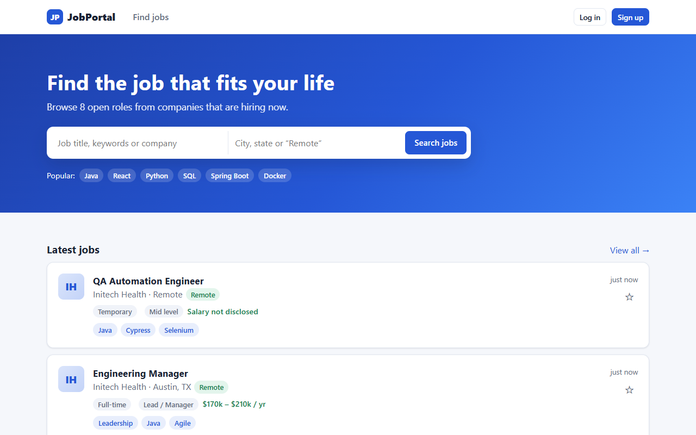

### Job seeker
| Search with filters | Job details |
|---|---|
| 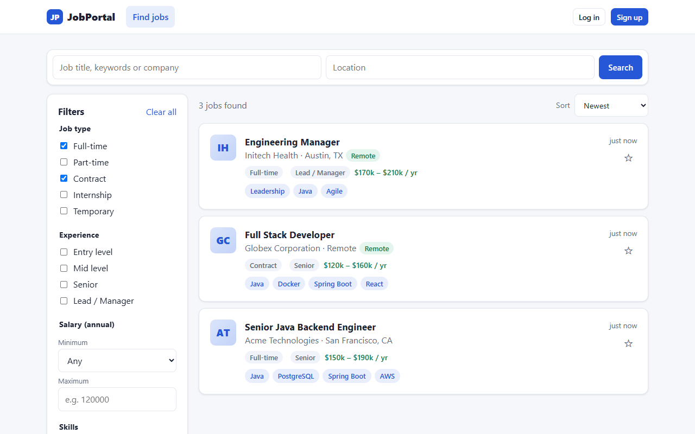 | 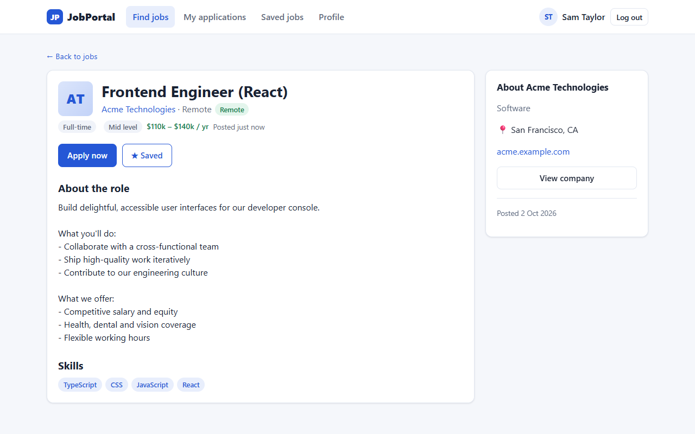 |
| **Apply with resume and cover letter** | **Track applications** |
| 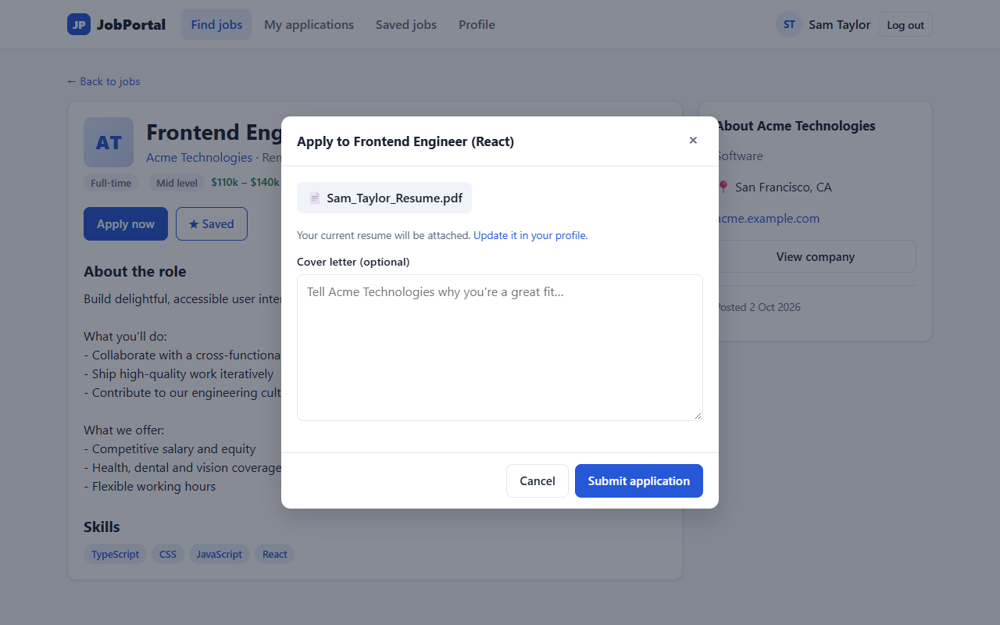 | 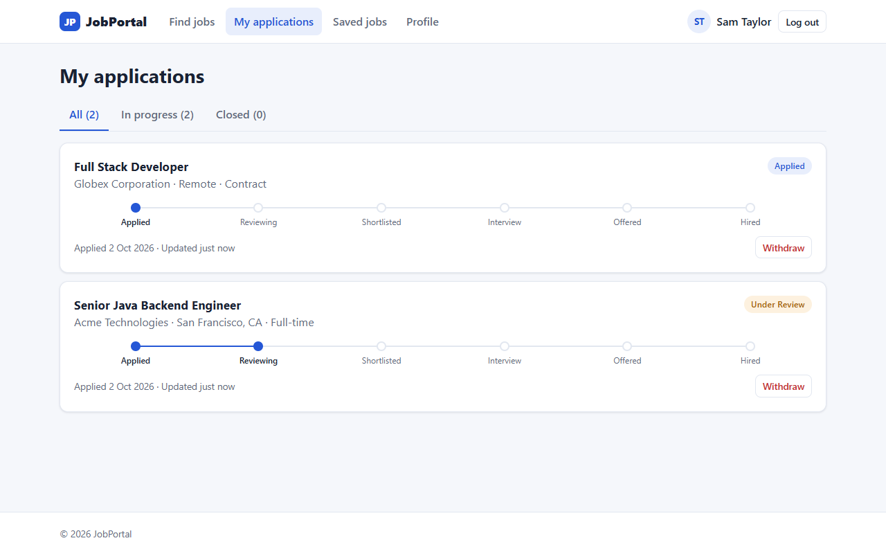 |
| **Profile and resume** | **Mobile** |
| 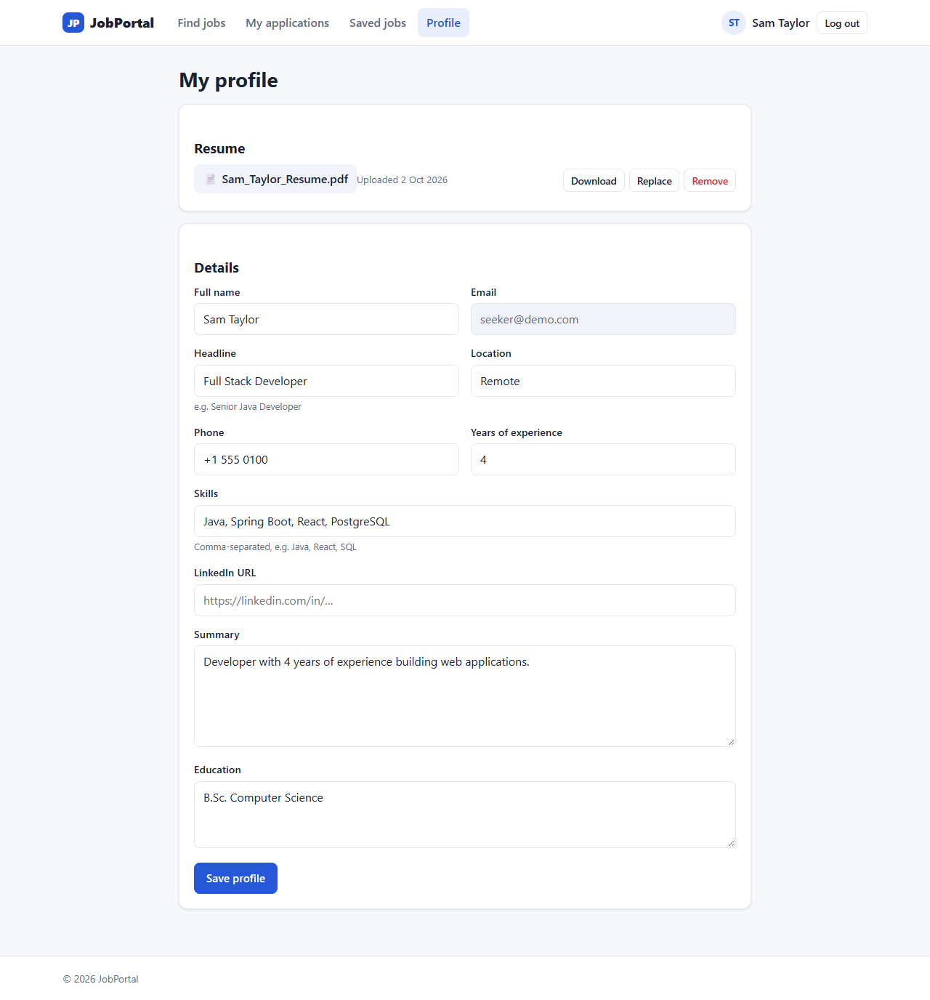 | 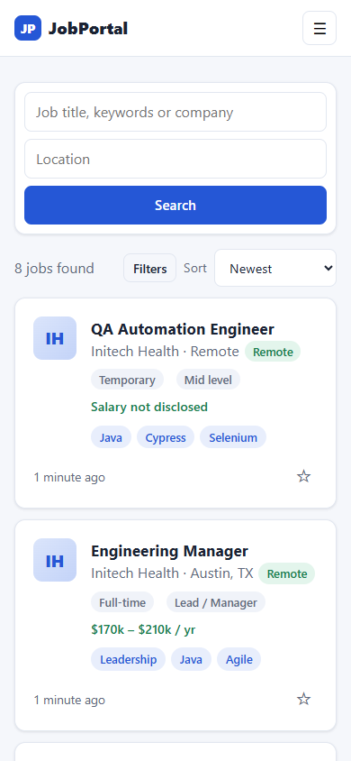 |

### Employer
| Job postings | Applicants |
|---|---|
| 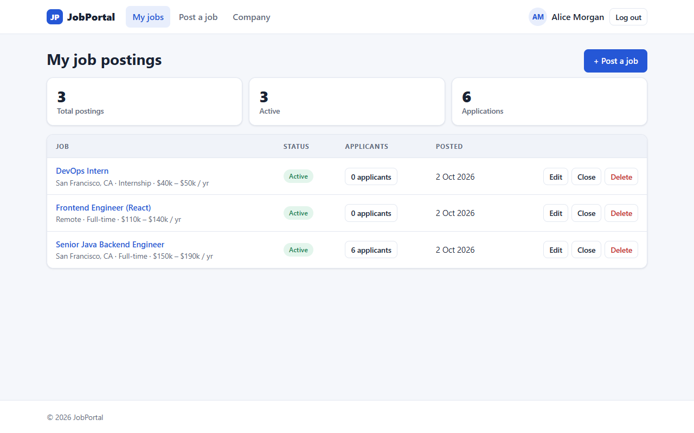 | 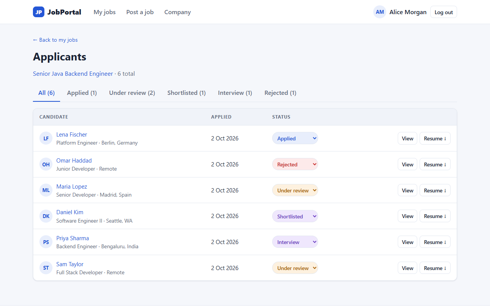 |
| **Post a job** | |
| 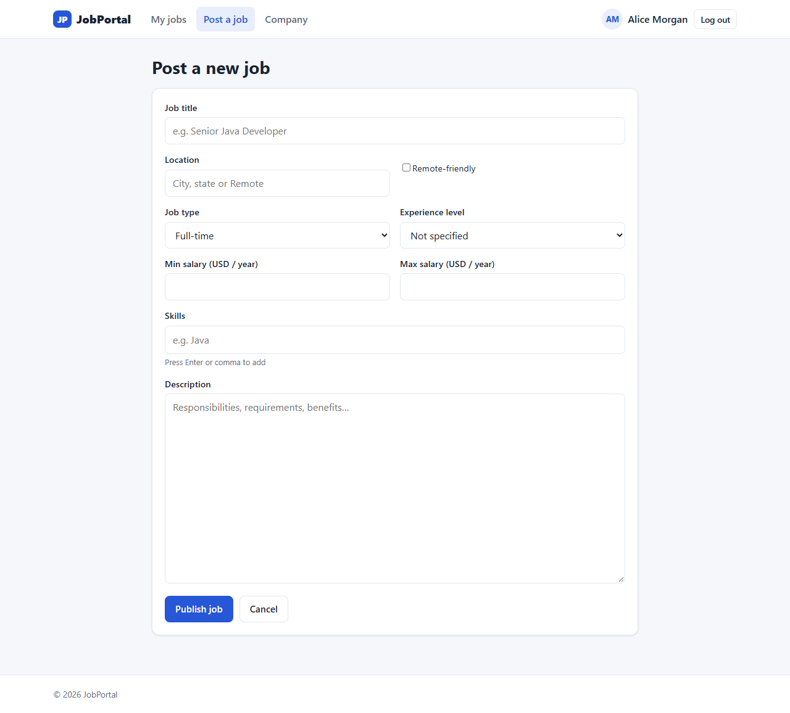 | |

### Admin
| Platform statistics | Moderate job postings |
|---|---|
| 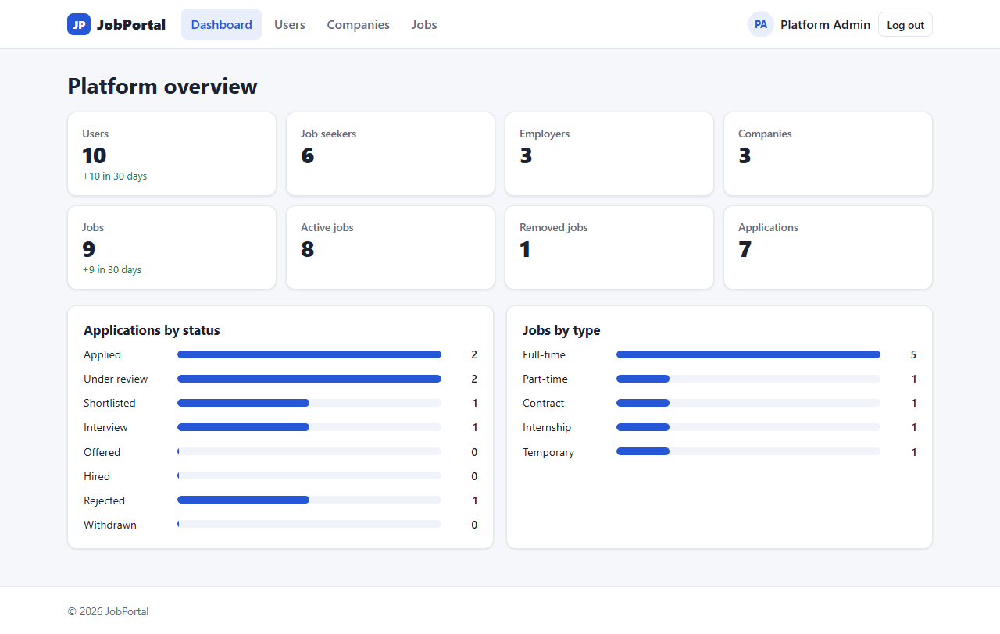 | 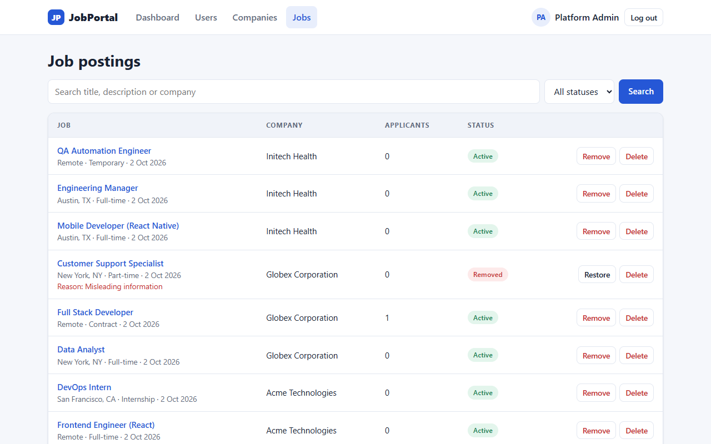 |

## Features

**Job seeker**: register/login · profile (headline, skills, experience, education, links) · upload/replace/download resume (PDF/DOC/DOCX, 5 MB) · search jobs with keyword, location, job type, experience level, salary range, skills, and remote filters, plus sorting · apply with a cover letter · track application status through a pipeline view · withdraw and re-apply · bookmark jobs

**Employer**: register/login · company profile (with a public company page) · post, edit, close/reopen, delete jobs · view applicants with their profiles and cover letters · download resumes · move applications through `Applied → Reviewing → Shortlisted → Interview → Offered → Hired / Rejected`

**Admin**: platform statistics dashboard · search/enable/disable/delete users · list and delete companies · list jobs, remove inappropriate listings with a reason (hidden from the public; the employer can't republish), restore them, or delete them permanently

## Running locally

### Prerequisites
- Java 21+ (Maven is not needed because the Maven wrapper is included)
- Node 18+
- PostgreSQL running locally

### 1. Database
```sql
CREATE DATABASE jobportal;
```
Hibernate creates the tables on first start (`ddl-auto: update`).

### 2. Backend (port 8080)
```powershell
cd backend
$env:DB_PASSWORD="your-postgres-password"   # bash: export DB_PASSWORD=...
./mvnw spring-boot:run
```

### 3. Frontend (port 5173)
```bash
cd frontend
npm install
npm run dev
```
Open http://localhost:5173. Vite forwards `/api` requests to the backend.

### Demo accounts (seeded on an empty database)
| Role       | Email                 | Password       |
|------------|-----------------------|----------------|
| Admin      | admin@jobportal.com   | Admin@123      |
| Employer   | employer@demo.com     | Password@123   |
| Job seeker | seeker@demo.com       | Password@123   |

Use the login page's "Demo accounts" buttons to fill these in. To turn off the demo data, set `SEED_DEMO=false`. The admin account is always created.

## Configuration (environment variables)

| Variable          | Default                                        |
|-------------------|------------------------------------------------|
| `DB_URL`          | `jdbc:postgresql://localhost:5432/jobportal`   |
| `DB_USERNAME`     | `postgres`                                     |
| `DB_PASSWORD`     | `postgres`                                     |
| `JWT_SECRET`      | dev key (base64, ≥256-bit). **Change it in production** |
| `JWT_EXPIRATION_MS` | `86400000` (24h)                             |
| `UPLOAD_DIR`      | `uploads` (resume storage)                     |
| `CORS_ORIGINS`    | `http://localhost:5173`                        |
| `ADMIN_EMAIL` / `ADMIN_PASSWORD` | `admin@jobportal.com` / `Admin@123` |
| `SEED_DEMO`       | `true`                                         |

## REST API

All endpoints are under `/api`. Authenticated calls send `Authorization: Bearer <token>`.

| Method | Path | Access |
|---|---|---|
| POST | `/auth/register`, `/auth/login` | public |
| GET | `/auth/me` | any user |
| GET | `/jobs?q&location&type&level&minSalary&maxSalary&skills&remote&sort&page&size` | public |
| GET | `/jobs/{id}`, `/companies/{id}` | public |
| POST | `/jobs/{id}/apply` | seeker |
| GET/PUT | `/seeker/profile` | seeker |
| POST/GET/DELETE | `/seeker/profile/resume` | seeker |
| GET | `/seeker/applications` · PATCH `/seeker/applications/{id}/withdraw` | seeker |
| GET | `/seeker/saved-jobs` · PUT/DELETE `/seeker/saved-jobs/{jobId}` | seeker |
| GET/PUT | `/employer/company` | employer |
| GET/POST | `/employer/jobs` · GET/PUT/DELETE `/employer/jobs/{id}` | employer |
| GET | `/employer/jobs/{id}/applications` | employer (own jobs) |
| PATCH | `/employer/applications/{id}/status` · GET `/employer/applications/{id}/resume` | employer (own jobs) |
| GET | `/admin/stats` | admin |
| GET | `/admin/users?q&role` · PATCH `/admin/users/{id}/status` · DELETE `/admin/users/{id}` | admin |
| GET | `/admin/companies?q` · DELETE `/admin/companies/{id}` | admin |
| GET | `/admin/jobs?q&status` · PATCH `/admin/jobs/{id}/status` · DELETE `/admin/jobs/{id}` | admin |

## Design notes
- **Security**: stateless JWT (HS256) with BCrypt passwords and role-based URL rules. Users are loaded from the database on every request, so disabling an account takes effect right away, even for tokens that haven't expired. Admin accounts can't be self-registered.
- **Ownership**: employers can only see and change their own jobs and applicants. Requests for another employer's resources return 404.
- **Resumes** are stored on disk outside the web root. The app validates file extensions and blocks path traversal. Each application keeps its own copy of the resume, so an employer always sees the version that was submitted, even if the seeker replaces it later.
- **Deletes** cascade at the database level (`ON DELETE CASCADE`). For example, deleting a user also removes their company, jobs, applications and saved jobs, and the app deletes the related resume files.
- **Search** uses JPA Specifications. The skills filter matches any of the given skills. The salary filters match any job whose salary range overlaps the requested range.

## License

Released under the [MIT License](LICENSE).
